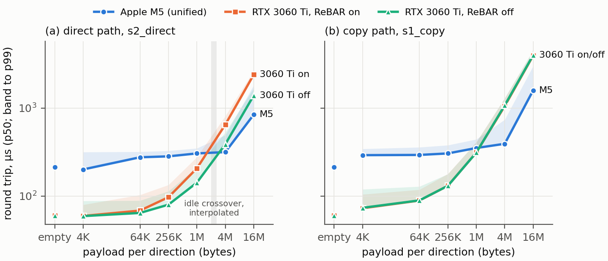

# §3 Platforms and §5 M1 results, idle GPU (draft, 2026-10-16)

<!-- Sources: results/m1_report/report.md (M5 vs 3060 Ti ReBAR on, built at 45b6182),
     results/m1_report_rebar-off/report.md, docs/PC_REPORT.md §1 and §4.4, Mac CSV headers (results/m1_mac_ac),
     docs/STATUS.md "M1 combined report". µs values are p50 / p99, chain submission, spin wait, 3 process runs pooled. -->

## §3 Platforms

**Table 1** The two platforms

| | P-M5 | P-3060 |
|---|---|---|
| system | MacBook Air 15" (Mac17,4), fanless | desktop, MSI MS-B9241 board |
| CPU | Apple M5, 4 performance + 6 efficiency cores | Intel Core i7-12700F, 12 cores / 20 threads |
| GPU | Apple M5, 10 cores, unified memory | NVIDIA RTX 3060 Ti, 8 GB |
| memory | 24 GiB unified | 32 GB system |
| link | none (shared memory) | PCIe **gen3** x16, measured under load in every run |
| OS / driver | macOS 26.6.2 (25G83) | Windows 11 (10.0.26200), driver 566.36 |
| API | Metal (metal-cpp) | Vulkan 1.3.289 |
| power | AC, Low Power Mode off; thermal state "fair" throughout | Ultimate Performance plan, "Prefer maximum performance" |
| ReBAR | n/a | on (BAR heap 8024 MB, primary) and off (214 MB, separate series) |

The protocol planned PCIe 4.0. The board's slot runs at gen3, so the measured link is the platform definition.
For H5's link-width comparison, both RTX cards run in the same slot (x16 vs x8, both gen3). The RTX 4060 Ti
(P-4060) is pending.
<!-- Mention in §12: one Mac series on battery (2026-09) was excluded, and the protocol requires AC. -->

## §5 Results with the GPU idle: H1 is refuted

**Fig. 1** *CPU↔GPU round trip against payload per direction, GPU otherwise idle, chain submission, spin wait;
line = p50 pooled over three runs, band up to p99. (a) direct path, (b) copy path. The grey column in each panel
spans where the M5's curve crosses the 3060 Ti's, interpolated in log–log between neighbouring grid points (min–max
over the nine pairs of runs and both ReBAR settings); nothing was measured inside it.*
<!-- Regenerate with `python3 tools/analysis/paper_fig1.py` (reads `results/m1_report*/summary.csv` and `results/m1_crossover/crossover.csv`). -->

**The criterion, fixed in advance:** the M5's empty and 1 MiB round-trip p50 must be lower than both RTX cards' best Vulkan path by more than run-to-run noise. It fails on both cells, with and without ReBAR (Table 4).

**Table 4** Round trip p50 / p99 in µs with the GPU idle (chain submission, spin wait, three runs pooled), and raw copy bandwidth

| | M5 (shared memory) | 3060 Ti, ReBAR on | 3060 Ti, ReBAR off |
|---|---:|---:|---:|
| empty round trip | 214 / 316 | 60 / 85 | 60 / 99 |
| 1 MiB, best path | 305 / 349 (`s2_direct`) | 160 / 230 (`s2_hostcached`) | 142 / 212 (`s2_direct`) |
| 1 MiB `s1_copy` | 352 / 442 | 312 / 412 | 312 / 408 |
| 16 MiB `s2_direct` | 842 / 1814 | 2395 / 2650 | 1392 / 1684 |
| 16 MiB `s1_copy` | 1587 / 3001 | 3940 / 4437 | 3983 / 4583 |
| raw copy, 16 MiB (to host / to device) | 55.4 / 57.9 GB/s | 12.4 / 13.3 GB/s | 12.6 / 13.2 GB/s |

On the two criterion cells the M5 is 1.9–3.5× **slower**: 213.5 vs 60.4 µs empty, and 305.5 vs 159.8 µs (ReBAR on)
or 142.3 µs (ReBAR off) at 1 MiB.

**Where the time goes: the hand-off, not the bytes.** The PC's GPU→CPU and CPU→GPU hand-offs are each ≈ 30 µs
and unimodal (g2c 30–35 µs in 73 % of samples). On the M5, g2c is similar (≈ 38 µs p50). The CPU→GPU hand-off,
though, is **multimodal**, with modes at ≈ 50, 155 and 235 µs. Which mode dominates persists for minutes and
changes between runs. This pattern is consistent with the GPU leaving an idle power state, and §6 tests that
reading directly. The multimodality is also why the M5 fails the run-to-run acceptance (26 of 52 cells vary by
≥ 10 % across process restarts; worst primary cell 29 %). The PC passes (0 of 124 cells; worst 8.4 %).

**Where the M5 wins: payload cost.** From 4 KiB to 1 MiB the M5's `s2_direct` round trip grows only from 201
to 305 µs. The 3060 Ti's grows from 60 to 207 µs (ReBAR on) and keeps growing linearly with payload. At 16 MiB
the M5 is 1.7–2.8× faster on the direct path and ≈ 2.5× on the copy path. Raw copy bandwidth is ≈ 4.5× that of
the gen3 x16 link. Against the 3060 Ti's best path, log–log interpolation between the 1 and 4 MiB grid points puts
the crossover at ≈ 2.4 MiB per direction with ReBAR on (2.25–2.44 MiB over the nine pairs of runs) and ≈ 3.0 MiB
with ReBAR off (2.78–3.06 MiB). Path by path, the curves of Fig. 1 cross at ≈ 1.6 MiB (direct path, ReBAR on),
≈ 3.0 MiB (direct path, ReBAR off) and ≈ 1.2 MiB (copy path, both settings). Nothing was measured between 1 and
4 MiB; the §6 extension measures it.
<!-- results/m1_crossover/crossover.md (tools/analysis/crossover.py; idle, chain/spin). Until 2026-10-21 this said
     "≈ 2.0–2.6 MiB", which matched only the ReBAR-on best path and is also H1′'s prediction interval; the
     prediction itself (protocol §1) is unchanged. -->

**ReBAR changes only `s2_direct`.** With ReBAR on, the CPU→GPU buffer lives in device memory, so the CPU's
1 MiB write crosses PCIe (96 vs 33 µs), while the GPU's read pass, which `rt` excludes, becomes almost free
(7 vs 86 µs). `rt` therefore rises from 142 to 207 µs. We report `rt` as defined and give `rt` + GPU read as a
secondary figure. Every other path agrees within a few percent between the two series.
<!-- PC_REPORT §4.4. Sensitivity paths s2_rebar (CPU reads uncached device memory: 437 ms at 1 MiB) and
     s2_coherent (15 ms) confirm the strawman reasoning of DECISIONS #17; mention them in one sentence only. -->

**Outcome.** H1 ("lower for all payload sizes") is refuted. The data show a crossover, which the protocol named
in advance as the expected honest outcome for the frame-level hypotheses. The study was re-scoped to H1′
(§1), with its predictions written down before the extension was measured.
